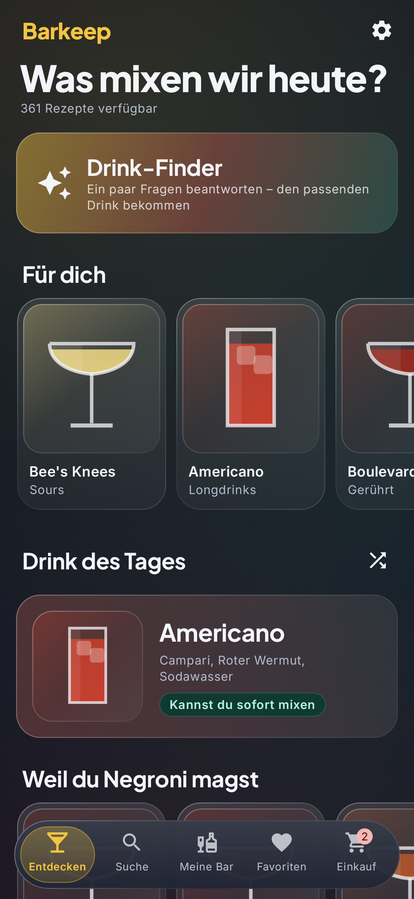
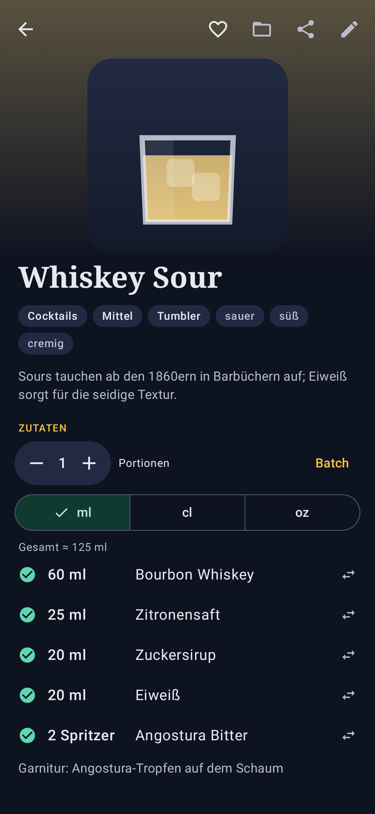
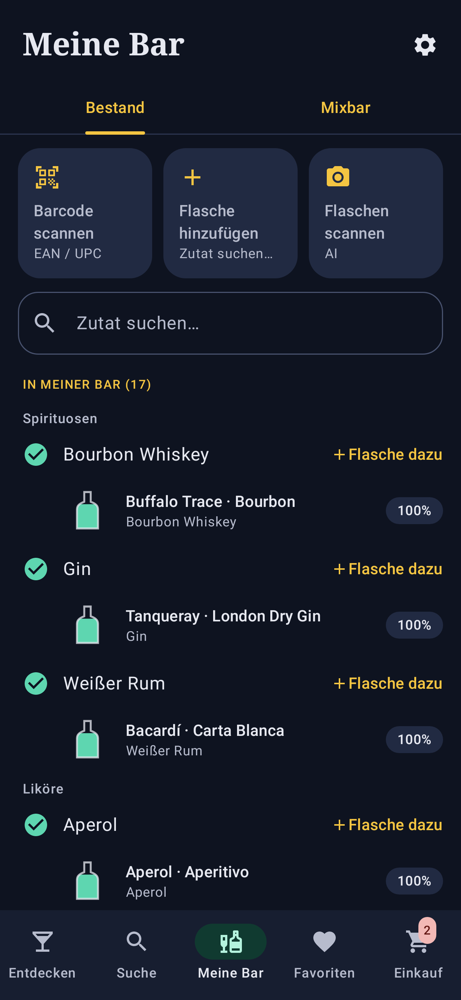
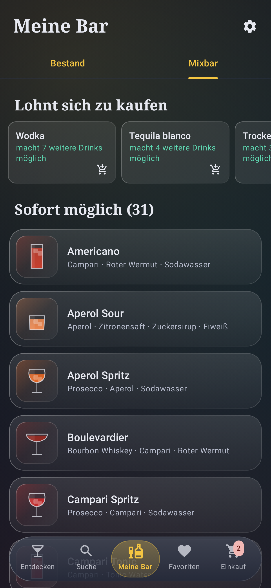
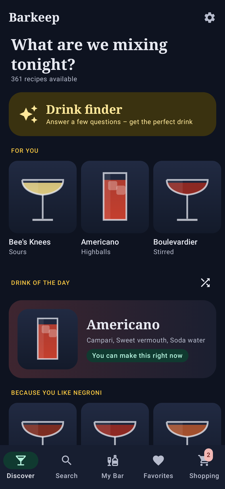
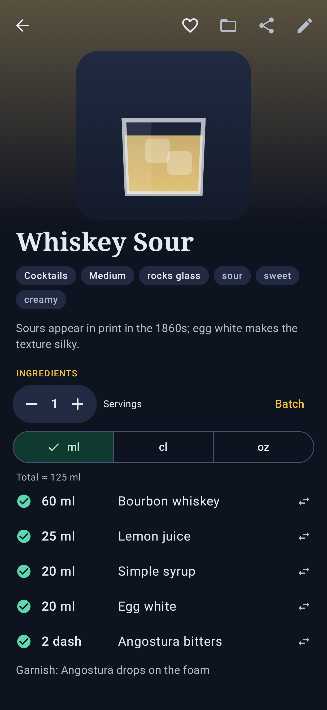
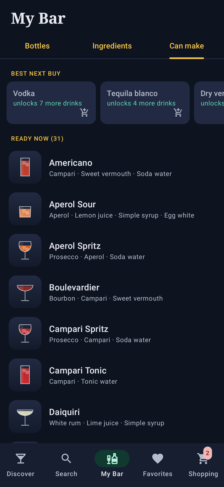
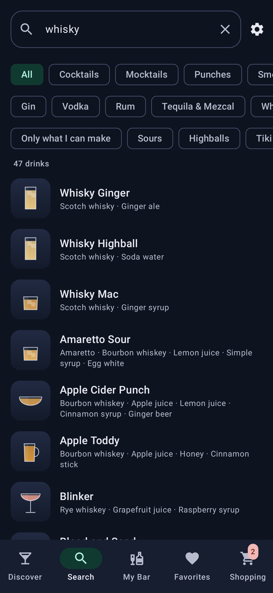

# 🍸 Barkeep

**Deine Hausbar in der Hosentasche – kostenlos & Open Source.**
*Your home bar in your pocket – free & open source.* ([English below](#english))

<p>




</p>

## Funktionen

- **Meine Bar** – Flaschen per **Barcode-Scanner** (EAN/UPC, Produktdaten von Open Food Facts), per Suche oder per KI-Foto erfassen, mit Füllstand. Dazu frische Zutaten zum Abhaken.
- **Was kann ich mixen?** – sofort mixbar, eine/zwei Zutaten fehlen, mit Ersatz-Zutat möglich, plus „Lohnt sich zu kaufen“: welche Flasche die meisten neuen Drinks freischaltet.
- **Rezepte** – eigene zweisprachige Sammlung (DE/EN) aus Klassikern, Modern Classics, Tiki, Spritz, Mocktails, Bowlen, Punsch, Smoothies und Shots. Optional zuschaltbar:
  - **TheCocktailDB** komplett offline (~600 Rezepte mit Fotos)
  - **Community-Sammlung** (~7.000 Rezepte, nur für den privaten Gebrauch – siehe unten)
- **KI-Fotoerkennung** mit eigenem API-Schlüssel (Google Gemini, Claude oder OpenAI): Cocktail fotografieren → Name, Geschichte, Rezept; Zutaten fotografieren → ab in die Bar.
- **Einsteiger & Profis** – Schritt-für-Schritt-Modus, Technik-Tipps, ml/cl/oz-Umrechnung, Skalierung nach Portionen oder Zielmenge (Batching), Ersatz-Zutaten mit Geschmackshinweis.
- **Eigene Rezepte** – neu anlegen oder bestehende anpassen.
- **Favoriten in Ordnern**, **Einkaufsliste** (teilen, „gekauft → in meine Bar“), **Zufalls-Drink**, **Drink des Tages**, **Saisonales**, **ähnliche Drinks**, **Food-Pairing**.
- Deutsch & Englisch, Sprache in der App umschaltbar. Keine Werbung, kein Konto, keine Tracker.

## Installation

APK aus den [Releases](https://github.com/Schnubbirunkel/Barkeep/releases) laden und installieren (Android 8+).
Der Barcode-Scanner nutzt die Google-Play-Dienste (keine Kamera-Berechtigung nötig).

### iPhone, iPad & Browser (Web-App)

Barkeep läuft auch im Browser: **<https://schnubbirunkel.github.io/Barkeep/>**

Auf dem iPhone in **Safari** öffnen → **Teilen** → **Zum Home-Bildschirm**. Danach startet Barkeep wie eine App
im Vollbild und funktioniert nach dem ersten Laden auch offline. Benötigt iOS 18.2 oder neuer
(bzw. einen aktuellen Chrome/Firefox/Edge).

Unterschiede zur Android-App: Daten liegen im Browser-Speicher (Sicherung über *Einstellungen → Exportieren*
als Datei), der Barcode-Scanner nutzt die Kamera direkt im Browser.

## Datenquellen & Lizenzen

| Quelle | Inhalt | Hinweis |
|---|---|---|
| Barkeep-Sammlung (`tools/`) | eigene Rezepte DE/EN | eigene Texte, CC0 |
| [TheCocktailDB](https://www.thecocktaildb.com) | Online-Suche, Offline-Download | Testschlüssel „1“; eigener Schlüssel für Unterstützer |
| [Open Food Facts](https://world.openfoodfacts.org) | Barcode-Produktdaten | ODbL |
| Hugging Face `erwanlc/cocktails_recipe_no_brand` | Community-Sammlung | **unklare Lizenz** – wird nicht mitgeliefert, sondern erst nach Aktivierung direkt aufs Gerät geladen; nur privater Gebrauch |

Schriften: [Plus Jakarta Sans](https://fonts.google.com/specimen/Plus+Jakarta+Sans) & [Inter](https://rsms.me/inter/) (SIL Open Font License).

Rezeptdaten neu erzeugen: `python3 tools/gen_data.py` · Übersetzungen: `python3 tools/gen_strings.py`

## Bauen

```bash
gradle :app:assembleRelease          # APK
gradle :app:recordRoborazziDebug     # Screenshots nach docs/screenshots
gradle -p web wasmJsBrowserDistribution   # Web-App nach web/build/dist/wasmJs/productionExecutable
gradle -p web wasmJsBrowserDevelopmentRun # Web-App lokal starten
```
GitHub Actions baut bei jedem Push; ein Tag `v*` erzeugt ein Release. Die Web-App wird bei jedem Push auf `main`
nach GitHub Pages veröffentlicht (einmalig in den Repo-Einstellungen *Pages → Source: GitHub Actions* wählen).

Die Web-App (`web/`) nutzt denselben Kotlin-Code wie die Android-App (Compose Multiplatform, WebAssembly).
Nur die plattformabhängigen Teile – `data/Http.kt`, `data/Stores.kt`, `data/Sources.kt` und `ui/Platform.kt` –
haben eine eigene Web-Version unter `web/src/wasmJsMain/kotlin/web/`.

---

## English

<p>




</p>

Barkeep is a free cocktail app: manage your home bar (barcode scanner via Open Food Facts, fill levels, fresh ingredients), see what you can make right now, browse a bilingual built-in recipe collection plus optional TheCocktailDB (offline) and a community collection (private use), identify drinks or ingredients from a photo using your own Gemini/Claude/OpenAI key, scale and batch recipes, get substitutes, food pairings, folders, a shopping list and a step-by-step mode. German & English UI.

**iPhone / iPad / browser:** open <https://schnubbirunkel.github.io/Barkeep/> in Safari → Share → *Add to Home Screen*
(iOS 18.2+). It runs full-screen and works offline after the first load.
